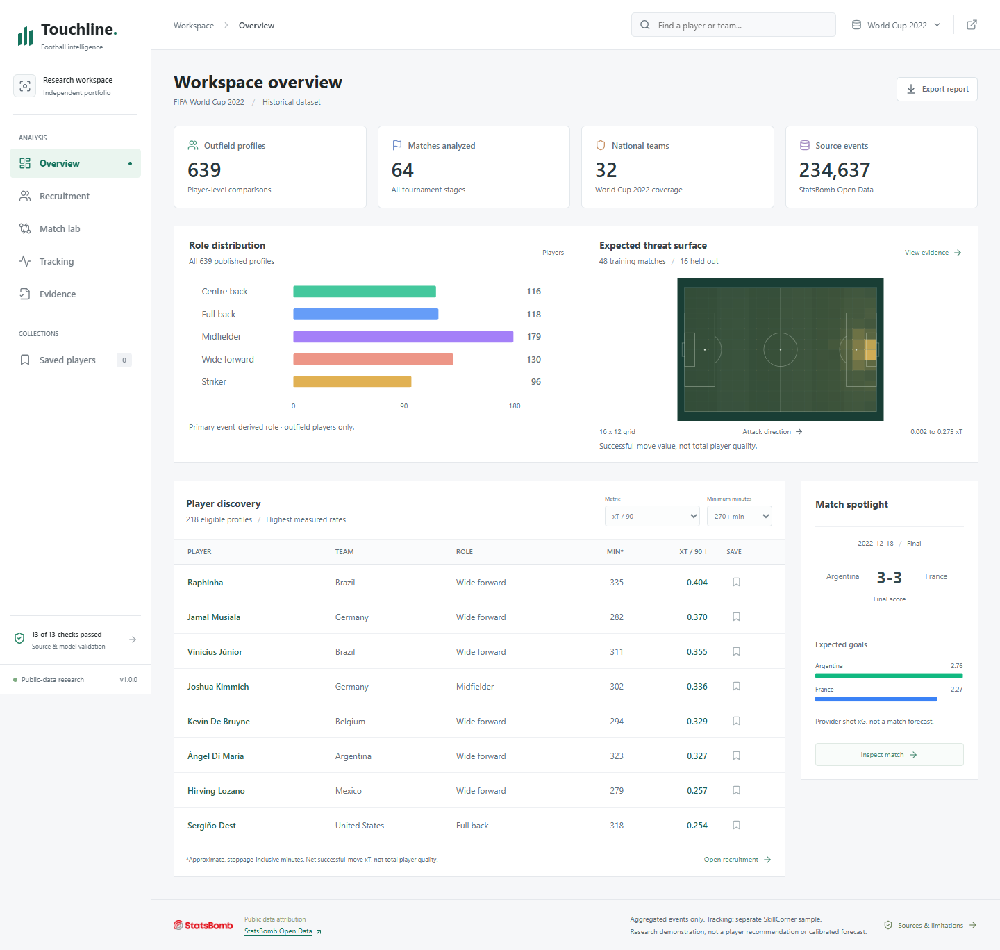
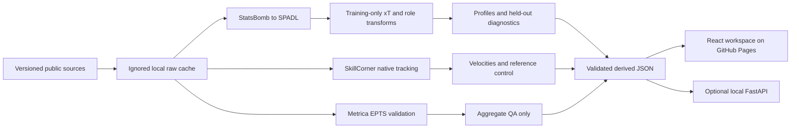

# Touchline Decision Lab

[Open the research workspace](https://vedantt17.github.io/touchline-decision-lab/) | [Decision memo](docs/DECISION_MEMO.md) | [Methods](docs/SIMILARITY.md) | [Tracking model](docs/TRACKING.md) | [Evidence](artifacts/evidence.json)

A public-data soccer research workbench for the question: **which players have similar measured styles, what distinguishes them, and what evidence should a scout review next?** It connects player comparisons, successful-move possession value, aggregate match patterns, and a separate tracking-control laboratory.

Built by Vedant Tiwari with AI coding assistance and established open-source football research libraries. Historical research only: not current MLS recruitment advice, a transfer-success model, or a club production system.

## A two-minute review

1. Start in **Overview** for dataset coverage, role distribution, the learned xT surface, and a filterable player-discovery table. Global player search opens a reference directly in Recruitment. Saved players and exports work across the workspace.
2. Choose a reference in **Recruitment**. Compare same-role candidates with an explicit minutes floor. Switch between a ten-metric profile and a 60-bin spatial fingerprint.
3. Change one group weight, compare profiles, and inspect the source-linked research note. Save candidates locally or export the current comparison as CSV.
4. Open **Match lab** to compare published team passing/carrying lanes with the learned xT surface. Lanes aggregate at least five moves; they are not event replays.
5. Open **Tracking**, play the real SkillCorner excerpt, and inspect Home control alongside detected/extrapolated player flags. It is a different match from the event data.
6. Open **Evidence** for chronological splits, baselines, checks, provider scope, and limitations.



## What is implemented

- **234,637 original events**, 64 World Cup 2022 matches, 639 outfield player profiles, 1,995 player-match records.
- Source-pinned ingestion with SHA-256 manifests, SPADL conversion, local SQLite outputs, and finite-value publication checks.
- Training-only role priors and feature scaling; exposure shrinkage; group-normalized weighted cosine; 300-replicate, seeded 90% match-bootstrap xT intervals.
- Ten measured features and a separately normalized 60-bin pass/carry/pressure fingerprint. Similarity is signed cosine x 100, not a probability of quality.
- Expected threat fitted on **48 group-stage matches** and examined on **16 later knockout matches**, retaining failed-move transition mass.
- A real **20-keyframe SkillCorner** excerpt (22 players per frame), native-rate velocity smoothing and reference pitch-control integration on a 16 x 10 grid.
- **5,000 Metrica frames** validated locally through kloppy; only aggregate QA is released.
- React/TypeScript interface, watchlist, CSV/scout-note exports, keyboard-accessible controls, reduced-motion handling, and an optional read-only FastAPI service.

## Results that matter

| Diagnostic | Result | What it means |
|---|---:|---|
| Temporal same-player top-3 retrieval, metric profile | 18.4% | 76 eligible queries; stability proxy, not scouting accuracy |
| Temporal same-player top-3 retrieval, spatial profile | 31.6% | Same queries and role-specific candidate pools |
| Pool-adjusted random top-3 baseline | 3.7% | Uniform random rank in each actual role pool |
| Held-out move-start xT Brier | 0.017578 | Possession-goal proxy, not match outcome prediction |
| Constant baseline Brier | 0.017675 | Only a small improvement; no strong performance claim |
| Coarse 8 x 6 grid Brier | 0.017569 | Finer grid is not clearly better; retained as a sensitivity check |
| Release data/model checks | 13 passing | Numeric, identity, split, scope, aggregation, and control checks |

The spatial baseline is more stable on this sample. Both models remain sensitive to match context, role assignment, and short exposure. Public comparison profiles use the whole historical tournament; temporal evaluation uses distinct training/held-out windows. See saved evidence for denominators and exact IDs.

## Architecture



## Run locally

Python 3.12 and Node 22 recommended. Committed derived data is enough to run the UI; no paid credentials are needed.

```bash
npm ci
npm run dev -- --port 8788
```

To reproduce the analysis (downloads public data; raw caches stay local):

```bash
python -m venv .venv
# Activate .venv for your shell
pip install -r requirements.txt
python scripts/fetch_data.py
python -m pipeline.build
python -m pytest -q
npm run build
```

The complete rebuild processes all 64 matches. An ignored, source-hashed analysis cache accelerates subsequent builds. Only load the project's own generated pickle; never substitute an untrusted cache. Public files are derived analysis, not original event/position archives.

Optional local API:

```bash
uvicorn api:app --host 127.0.0.1 --port 8789
```

Endpoints: `/health`, `/api/players`, `/api/players/{id}/neighbors`, `/api/evidence`; interactive documentation at `/docs`. GitHub Pages serves the static research UI, not this Python API. There is no authentication or sensitive data; this optional service should remain local rather than being treated as a hardened multi-user deployment.

## Verification and deployment

```bash
python -m pytest -q
npm run build
npm audit --omit=dev
npm run test:browser
```

The browser script requires Chrome and a running local UI (or `BASE_URL` for another deployment). CI runs Python unit/release-contract tests and the production build. Real-source tests run only when local raw samples exist; published artifact contracts run in CI. GitHub Actions publishes `dist/` to Pages after validation. No server keys are shipped in the client.

## Data and limits

StatsBomb Open Data supplies historical events. SkillCorner supplies a different historical match, Auckland FC vs Wellington Phoenix on December 7, 2024. Metrica's separate anonymized Game 3 is used for adapter QA, not paired tracking validation. See [third-party terms](THIRD_PARTY.md) and [source manifest](data/source_manifest.json).

Successful-move xT omits complete turnover/defensive attribution. Possession-goal labels include goals within regulation/extra time but not shootouts; repeated move-start observations are dependent. The tournament-stage split introduces distribution shift. The pitch-control model uses uncalibrated defaults, offline velocity smoothing, disabled offside filtering, and no ball-height model; the reference's second-population goalkeeper advantage makes the Home-first view asymmetric. Control mass may differ from unity by up to 0.01. A 9.5-second excerpt cannot establish match-level conclusions. No proprietary Opta, TRACAB, current MLS, injury, salary, or transfer-fee data is claimed.

## Next research steps

Evaluate multi-season, league-adjusted profiles with authorized club data; compare richer possession-value frameworks; calibrate control parameters against real outcomes; separate goalkeeper and outfield role models; add expert-reviewed video tags and prospective scouting feedback. None of those future capabilities is represented as complete.
